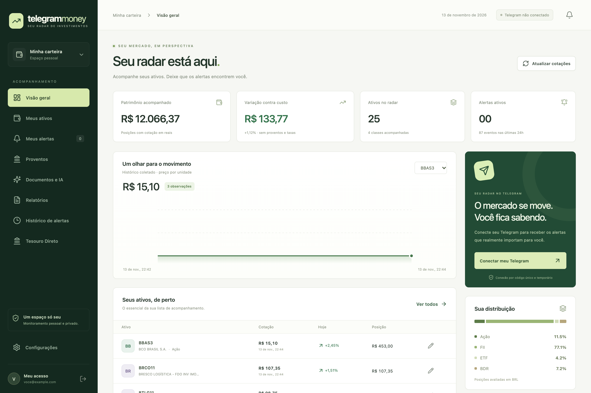
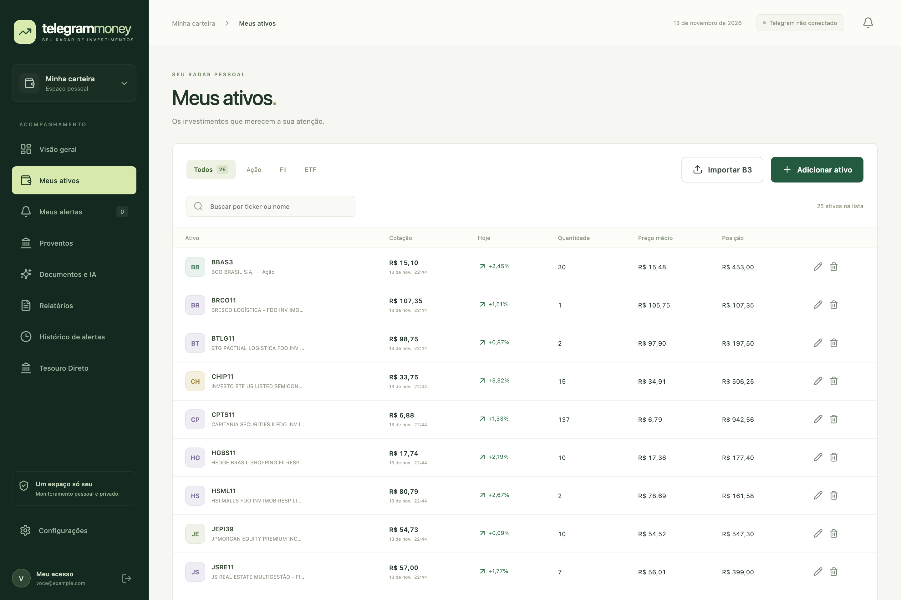
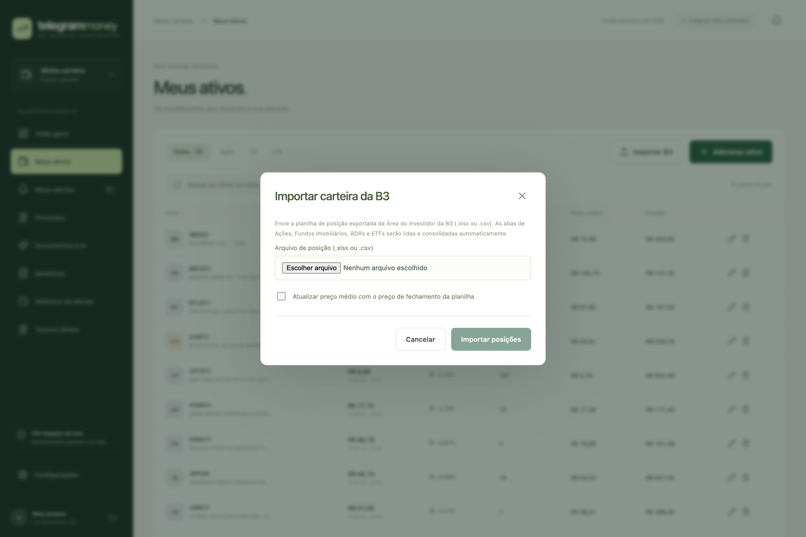
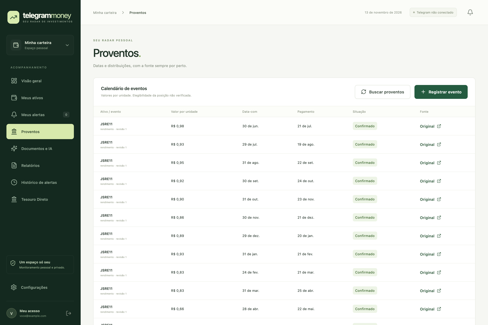
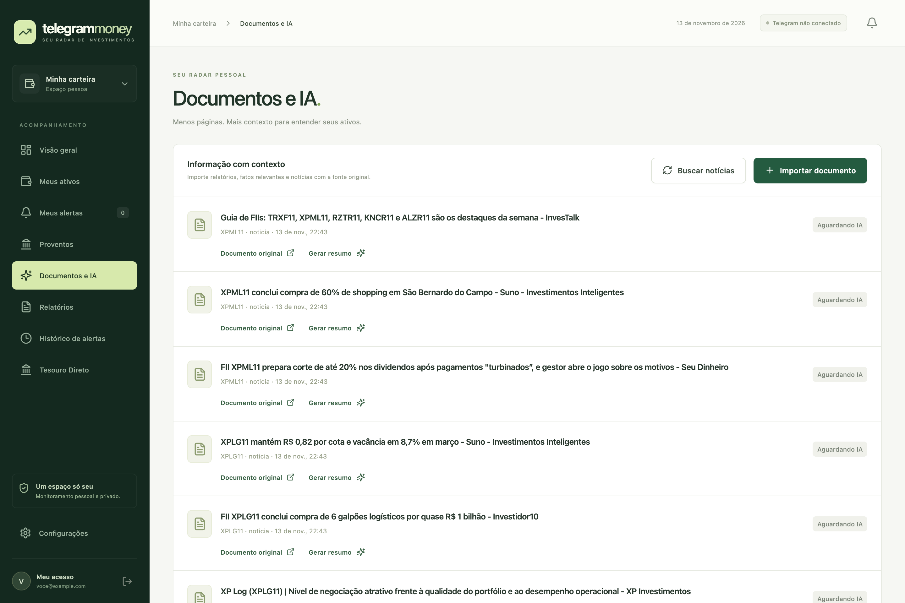
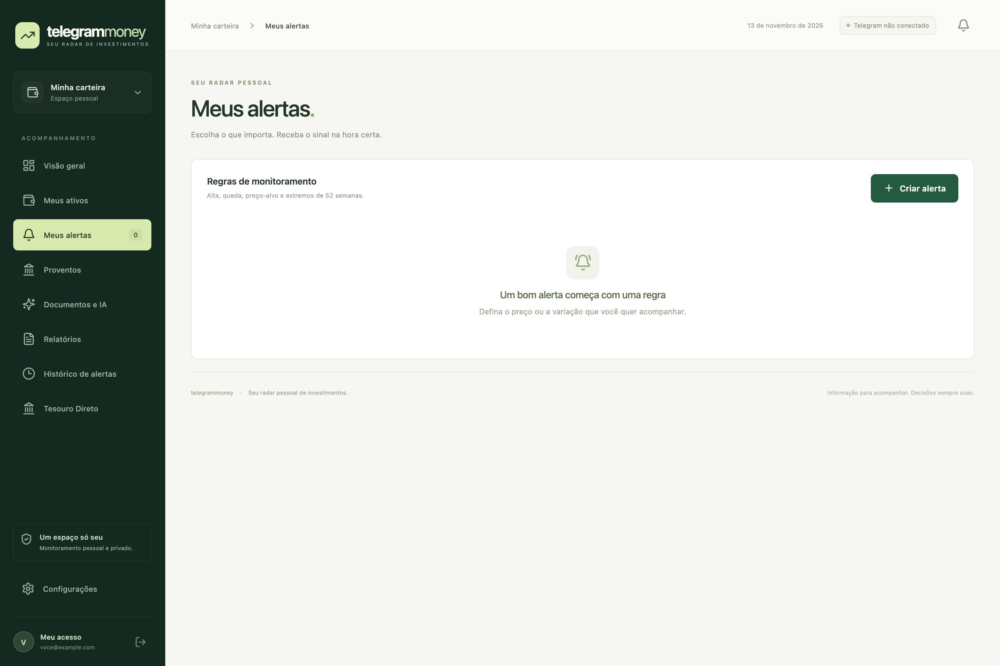
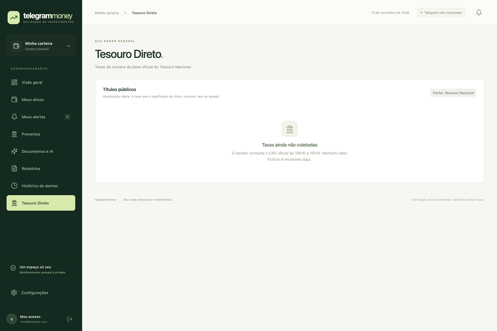
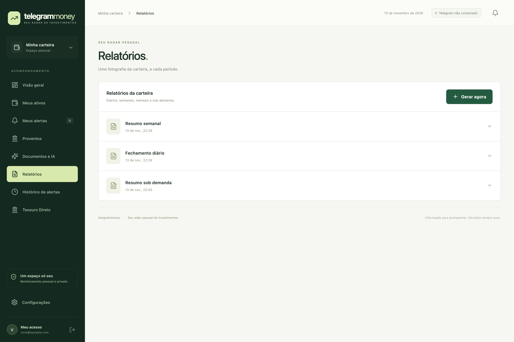
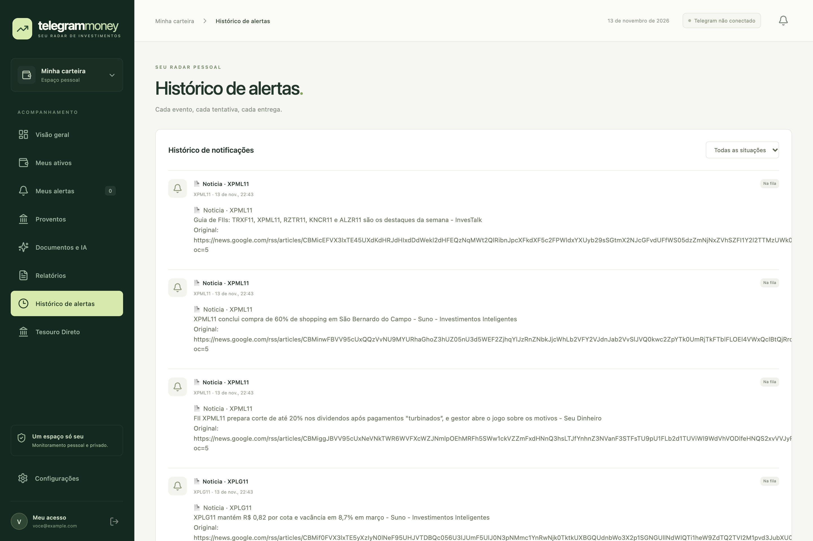
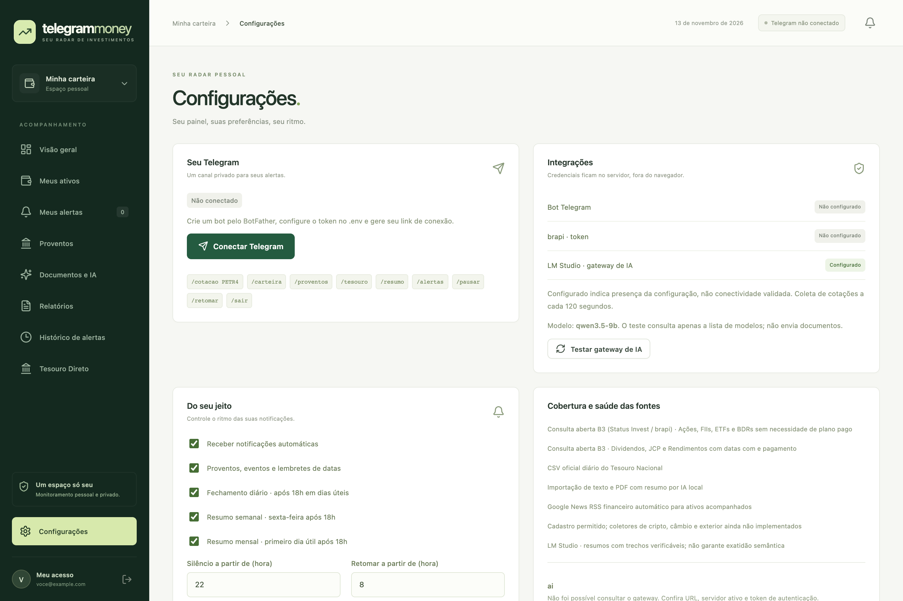

# Telegram Money

[](docs/implementacao.md)

> [!IMPORTANT]
> 🚧 **PROJETO EM DESENVOLVIMENTO ATIVO**
> Este sistema está em fase ativa de desenvolvimento e modernização. Funcionalidades de monitoramento, integração de APIs abertas, importações de custódia e inteligência analítica estão em constante evolução. Consulte a [matriz de implementação](docs/implementacao.md) e a [documentação de arquitetura](docs/arquitetura.md) para detalhes técnicos.

Monitor financeiro **pessoal** com painel React, API FastAPI, PostgreSQL, Redis, Celery e bot Telegram (aiogram). Adaptado para uso pessoal por um único proprietário, com suporte a APIs abertas gratuitas e sem dependência de planos ou assinaturas pagas.

---

## Telas do Sistema

### 1. Visão Geral (Dashboard)
Painel consolidado com patrimônio total, rentabilidade estimada, gráfico de alocação por classe de ativos e destaques de cotações em tempo real.


### 2. Meus Ativos & Carteira
Gestão completa dos ativos da carteira (ações, FIIs, ETFs, BDRs), quantidades, preço médio, cotação atual e variação diária.


### 3. Importação de Carteira da B3
Importação direta da posição de custódia emitida na Área do Investidor da B3 (`.xlsx` ou `.csv`), processada instantaneamente sem necessidade de digitação manual.


### 4. Proventos & Rendimentos
Acompanhamento de proventos provisionados e históricos (dividendos, JCP e rendimentos de FIIs), datas de corte (*data-com*) e datas de pagamento via provedores abertos da B3.


### 5. Notícias de Mercado & Análise por IA
Feed em tempo real de notícias financeiras dos ativos da carteira (via RSS aberto de fontes confiáveis brasileiras) e extração de fatos relevantes com IA local (LM Studio / Ollama).


### 6. Alertas e Regras de Mercado
Configuração de limites de preço, disparos por oscilação diária e monitoramento de máximas/mínimas de 52 semanas com deduplicação e rearme automático.


### 7. Tesouro Direto
Acompanhamento diário das taxas de rentabilidade e preços unitários dos títulos públicos federais direto da base oficial do Tesouro Nacional.


### 8. Relatórios Consolidados
Geração sob demanda e agendada de relatórios periódicos da carteira com evolução patrimonial e resumo de movimentações.


### 9. Histórico de Notificações
Auditoria completa de todas as notificações enviadas para o Telegram, tentativas de entrega, confirmações e fila persistente.


### 10. Configurações & Integrações
Ajustes de preferências, fuso horário, limites de envio, vinculação privada do bot do Telegram e diagnóstico do gateway de IA local.


---

## O que já existe

- **Status: Em desenvolvimento ativo**, com arquitetura modular desacoplada ([ver arquitetura](docs/arquitetura.md)).
- Login privado por e-mail e senha; sessão revogável em cookie HttpOnly e proteção de origem nas mutações.
- Importação direta de posições de custódia da **B3** via arquivo `.xlsx` (Área do Investidor) e `.csv`, tanto pelo painel web quanto via CLI (`python -m app.cli import-b3`).
- **Coleta de cotações aberta e gratuita** da B3 sem token ou plano pago, com fallback e preservação de dados.
- **Coleta de proventos aberta e gratuita** com extração de dividendos, JCP e rendimentos de FIIs provisionados e pagos.
- **Feed de notícias financeiras gratuitas** via busca RSS de mercado em português, com deduplicação por hash e extração inteligente.
- Alertas de preço acima/abaixo, alta/queda diária, oscilação absoluta e máximas/mínimas de 52 semanas.
- Rearme quando a condição volta ao normal; deduplicação de eventos e fila persistente no banco.
- Pausa, horário de silêncio, fuso, limite de mensagens por hora e reenvio manual.
- Vinculação Telegram por código temporário de uso único, comandos e menu inline.
- Taxas **diárias** do Tesouro Nacional por CSV oficial.
- Importação de texto/PDF e resumos com LM Studio (gateway padrão) ou Ollama local, incluindo evidências literais, interpretações e informações ausentes.
- Relatórios diários, semanais, mensais e sob demanda; download em texto.
- Histórico de tentativas, auditoria, migrations Alembic e scripts de backup/restauração.

Não inclui execução de ordens nem se conecta à corretora. Posições são informadas manualmente ou importadas da B3. Custo médio e quantidades não reconstroem operações históricas passadas.

## Executar com Docker

Requisitos: Docker Engine/Desktop ativo, Compose v2 e Python 3 para o assistente de configuração.

Na raiz do projeto:

```bash
python3 scripts/setup.py
docker compose up -d --build
```

O assistente solicita seu e-mail e senha (12+ caracteres), gera a senha do PostgreSQL e cria `.env` com permissão 600. **Não cole tokens ou senhas no chat nem os versione.** Se `.env` já existir, o assistente não o sobrescreve.

Abra [http://localhost:8000](http://localhost:8000). A API executa as migrations e cria o proprietário no primeiro início. Alterar `OWNER_PASSWORD` depois disso não muda a senha existente: use o comando de reset abaixo.

O painel funciona sem Telegram e sem IA, mostrando o que ainda falta configurar. O worker coleta somente ativos cadastrados. Banco e Redis não expõem portas no host. A API fica restrita a `127.0.0.1` por padrão.

### Conectar o Telegram

1. Crie um bot dedicado em [@BotFather](https://t.me/BotFather), usando `/newbot`.
2. Preencha **localmente** `TELEGRAM_BOT_TOKEN` e `TELEGRAM_BOT_USERNAME` (com ou sem `@`) em `.env`.
3. Reinicie os serviços para carregarem a configuração:

   ```bash
   docker compose --profile telegram up -d --force-recreate api worker beat bot
   ```

4. No painel, abra **Configurações → Conectar Telegram**, abra o link e toque em **Iniciar**. O código expira em 15 minutos e é consumido uma única vez.
5. Use **Enviar teste**. O teste segue pausa, silêncio e limite de envio; pode ficar na fila. Consulte o histórico.

O bot usa long polling; não precisa de domínio público ou webhook. Use apenas uma instância do bot. Se existir webhook no token informado, a inicialização é interrompida para não desfazer outra integração.

Comandos:

```text
/cotacao PETR4
/carteira
/proventos
/tesouro
/resumo
/alertas
/pausar
/retomar
/sair
```

Somente o chat privado vinculado acessa os dados. `/sair` desvincula o Telegram; não exclui a carteira nem o histórico.

### Configurar dados e IA

| Variável | Finalidade |
| --- | --- |
| `BRAPI_TOKEN` | Token do seu plano na brapi. Cobertura e limites dependem do plano. Sem token, apenas os tickers de teste permitidos pelo provedor podem funcionar. |
| `POLL_SECONDS` | Intervalo nominal de coleta, mínimo 30 segundos; padrão 120. Dimensione segundo as cotas do seu plano. |
| `AI_PROVIDER` | Gateway selecionado: `lmstudio` (padrão) ou `ollama`. Não há fallback automático. |
| `LM_STUDIO_BASE_URL` | API compatível com OpenAI do LM Studio. Local: `http://localhost:1235/v1`; em Docker Desktop: `http://host.docker.internal:1235/v1`. |
| `LM_STUDIO_MODEL` | ID exato de um modelo disponível no servidor LM Studio. Configurado como `qwen3.5-9b`, identificador do modelo carregado no servidor informado. |
| `LM_STUDIO_API_KEY` | Token opcional, caso a autenticação esteja ativada no LM Studio. Fica somente no backend. |
| `AI_TIMEOUT_SECONDS` | Timeout da geração de resumos, padrão 180 segundos. |
| `OLLAMA_URL` | URL de uma instância de Ollama sob seu controle. Local: `http://localhost:11434`; em Docker Desktop, para o Ollama do host: `http://host.docker.internal:11434`. |
| `OLLAMA_MODEL` | Nome exato de um modelo já instalado nessa instância. Usado somente com `AI_PROVIDER=ollama`. |
| `APP_ORIGIN` | Origem exata do painel. Padrão `http://localhost:8000`. Mutações com outra origem são rejeitadas. |
| `COOKIE_SECURE` | Use `true` se servir via HTTPS. Em localhost HTTP, mantenha `false`. |
| `DEMO_MODE` | Somente exemplos locais; bloqueia coleta automática e entrega de mensagens. Use um banco exclusivo de demonstração. |

As taxas do Tesouro não exigem token. O CSV é consultado às 10h10 e 15h10 no fuso configurado. Isso **não representa atualização intradiária em tempo real**. Consulte a data-base.

Os modelos de IA podem errar. A validação garante que as evidências citadas existem no texto recebido; não garante correção semântica das conclusões. Documentos são enviados apenas ao gateway selecionado na configuração. A compatibilidade com o protocolo OpenAI não usa a API da OpenAI: o endereço padrão é o servidor LM Studio local. Não há fallback silencioso para outro provedor.

### LM Studio como gateway de IA

1. No LM Studio, carregue um modelo com suporte a saída JSON estruturada e inicie o servidor na aba **Developer** (porta 1235, conforme o endereço informado).
2. Consulte o ID exato do modelo em `http://localhost:1235/v1/models` ou use **Configurações → Testar gateway de IA** no painel.
3. Configure no `.env`:

   ```dotenv
   AI_PROVIDER=lmstudio
   LM_STUDIO_BASE_URL=http://localhost:1235/v1
   LM_STUDIO_MODEL=qwen3.5-9b
   LM_STUDIO_API_KEY=
   AI_TIMEOUT_SECONDS=180
   ```

   Se API/worker estiverem em Docker Desktop e o LM Studio estiver no host, use `LM_STUDIO_BASE_URL=http://host.docker.internal:1235/v1`. O servidor do LM Studio precisa aceitar a conexão a partir dos containers; configure conscientemente o endereço de escuta e, se necessário, autenticação. O projeto não altera configurações do LM Studio.

4. Se a autenticação do LM Studio estiver habilitada, coloque o token em `LM_STUDIO_API_KEY`, localmente. O header `Authorization: Bearer` só é enviado quando há token.
5. Reinicie a API e o worker (`docker compose up -d --force-recreate api worker`). Clique em **Testar gateway de IA**: a verificação consulta somente `/v1/models`, sem enviar documentos nem gerar texto.
6. Importe um relatório e solicite o resumo. O worker envia mensagens para `/v1/chat/completions` com `response_format=json_schema`, temperatura zero e limite de saída. Respostas truncadas, JSON inválido e fatos sem evidência literal não são aceitos.

O botão verifica conectividade e presença do modelo na lista, não confirma que ele esteja carregado e não garante que esse modelo consiga gerar o JSON solicitado. Se a geração falhar, o documento mantém o texto original e o painel mostra o erro, permitindo nova tentativa. A camada `backend/app/services/ai.py` centraliza geração e descoberta de modelos, sem dependência do SDK OpenAI.

## Desenvolvimento local

Os padrões, a arquitetura e os comandos do painel estão em [frontend/README.md](frontend/README.md). As instruções para agentes ficam em [AGENTS.md](AGENTS.md) e [frontend/AGENTS.md](frontend/AGENTS.md).

Requisitos: Python 3.12 ou 3.13, [uv](https://docs.astral.sh/uv/), Node.js 22.13+ e npm.

```bash
python3 scripts/setup.py
cd frontend
npm ci
npm run build
cd ../backend
uv sync --frozen --python 3.12
uv run alembic upgrade head
uv run uvicorn app.main:app --host 127.0.0.1 --port 8000
```

No modo local, o `.env.example` usa SQLite em `backend/data/`. Para PostgreSQL, defina `DATABASE_URL=postgresql+psycopg://…`. O Compose substitui a URL automaticamente pela conexão interna do PostgreSQL.

Para a coleta e as notificações locais, execute Redis e, em terminais separados dentro de `backend/`:

```bash
uv run celery -A app.tasks:celery worker --loglevel=INFO --concurrency=1
uv run celery -A app.tasks:celery beat --loglevel=INFO
uv run python -m app.bot
```

Mantenha **um único beat** e um único processo do bot. No macOS, se o pool prefork do Celery tiver problemas de execução, use `--pool=solo` no desenvolvimento. Para Vite com hot reload, use `npm run dev` em `frontend/` e defina `APP_ORIGIN=http://localhost:5173` antes de iniciar a API. O Vite encaminha `/api` para a API em `127.0.0.1:8000`.

### Demonstração local, sem credenciais reais

Depois de instalar as dependências e compilar o frontend, dentro de `backend/`:

```bash
DATABASE_URL=sqlite:///./data/demo.db uv run alembic upgrade head
DATABASE_URL=sqlite:///./data/demo.db DEMO_MODE=true OWNER_PASSWORD='' TELEGRAM_BOT_TOKEN='' uv run uvicorn app.main:app --host 127.0.0.1 --port 8000
```

Entre com `demo@example.com` / `demonstracao-local` (preenchidos na interface). Valores, gráficos, proventos e notificações são **ilustrativos** e estão identificados. A demonstração bloqueia o worker e o envio; não use esse banco para sua carteira real. Não exponha a demonstração na internet.

## Testes e API

```bash
cd backend
uv sync --frozen --python 3.12
uv run pytest -q
```

Testes usam SQLite isolado, relógios controlados quando necessário e mocks HTTP; **não enviam mensagens reais nem consultam provedores externos**. Cobrem autenticação, proteção de origem, CRUD, eventos, rearme/deduplicação, atraso de cotações, silêncio, fila, limites, respostas do Telegram, vínculo de uso único, extração de referências e parsing de dados.

Documentação OpenAPI: [http://localhost:8000/docs](http://localhost:8000/docs). Faça login pelo painel para usar as rotas protegidas no mesmo navegador. As mutações exigem `Origin` igual a `APP_ORIGIN`; scripts de integração precisam enviar esse header e o cookie de sessão. Não há cadastro público, login social ou API key pública.

## Operação e recuperação

```bash
docker compose logs --tail=100 api worker beat
docker compose --profile telegram logs --tail=100 bot
bash scripts/backup.sh
bash scripts/restore.sh backups/arquivo.dump
docker compose exec api python -m app.cli reset-password
```

O reset solicita a nova senha no terminal e encerra todas as sessões. Os scripts de backup são **manuais**; agende o backup diário no seu servidor e teste a restauração em um ambiente separado. Não há agendamento de backup criado nesta entrega. Backups incluem carteira, sessões e vínculo Telegram: armazene-os com acesso restrito e criptografia adequada.

Redis mantém agendamentos e filas de execução; a fila de notificações é persistida no PostgreSQL. Os locks Redis evitam coletas concorrentes. O worker periódico recupera notificações elegíveis sem depender de uma task individual por mensagem.

Uma falha de conexão antes do envio permite retentativa com backoff. Um timeout de leitura pode acontecer **depois** de o Telegram receber a mensagem: a entrega passa a `uncertain` e exige conferência/reenvio manual. O Telegram não oferece uma chave de idempotência em `sendMessage`; a aplicação não promete entrega exatamente uma vez. Mensagens limitadas pelo Telegram são reprogramadas e têm limite de tentativas.

O backend mantém 400 dias de cotações. Eventos e logs não têm expurgo automático nesta versão. Relatórios longos ficam completos no painel; mensagens Telegram são limitadas a 4.000 caracteres.

Para disponibilizar fora do computador, será necessário configurar HTTPS, proxy confiável, origem e cookies seguros. A implantação atual é local. Nenhum recurso de nuvem foi criado, nenhum site foi publicado e nenhuma credencial real foi configurada.

## Estrutura

```text
backend/app/             API, modelos, bot, tarefas e serviços financeiros
backend/migrations/      Esquema versionado com Alembic
backend/tests/           Testes automatizados
frontend/src/            Painel React responsivo
scripts/                 Configuração, backup e restauração
docs/                    Requisitos originais e matriz de implementação
compose.yaml             API, PostgreSQL, Redis, worker, beat e bot opcional
```

Fontes primárias usadas na implementação: [brapi: cotações](https://brapi.dev/docs/acoes/cotacao), [brapi: proventos](https://brapi.dev/docs/acoes/dividendos), [brapi: rendimentos de FIIs](https://brapi.dev/docs/fiis/dividendos), [Tesouro Nacional: taxas diárias](https://www.tesourotransparente.gov.br/ckan/dataset/taxas-dos-titulos-ofertados-pelo-tesouro-direto), [Telegram Bot API](https://core.telegram.org/bots/api), [LM Studio: Chat Completions](https://lmstudio.ai/docs/developer/openai-compat/chat-completions), [LM Studio: JSON estruturado](https://lmstudio.ai/docs/developer/openai-compat/structured-output), [LM Studio: autenticação](https://lmstudio.ai/docs/developer/core/authentication) e [Ollama Chat API](https://docs.ollama.com/api/chat).

### Verificação no servidor informado

O servidor `http://localhost:1235/v1` respondeu e o modelo carregado foi identificado como `qwen3.5-9b`. A geração real de um resumo a partir de texto fictício foi concluída: JSON estruturado válido e dois fatos com evidências literais verificadas. O identificador anterior `qwen/qwen3.5-9b` apontava para outro registro não carregado e falhava; os padrões do projeto foram corrigidos para `qwen3.5-9b`. Nenhum documento pessoal ou dado de carteira foi usado nessa verificação.
