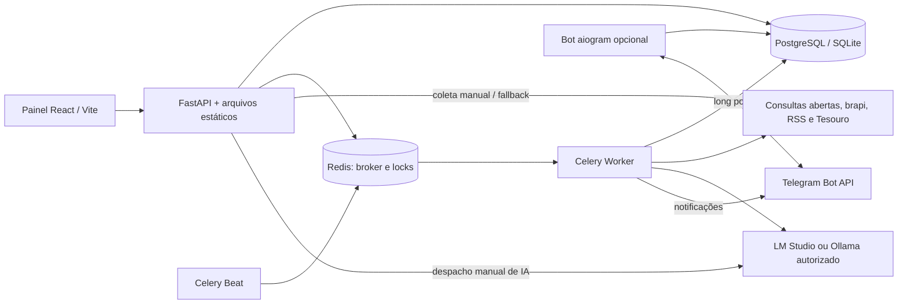
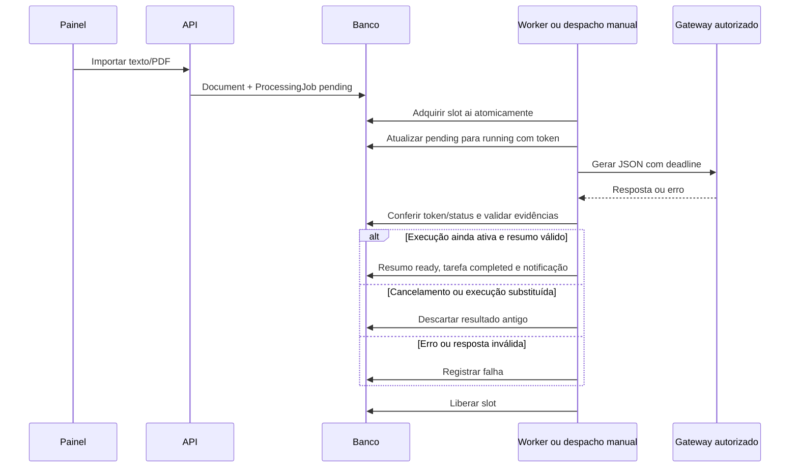

# Arquitetura do Telegram Money

Revisão documental: 14/11/2026. Este documento descreve o código atual. Instalação e recuperação estão no [README](../README.md); limites funcionais, na [matriz de implementação](implementacao.md).

## Escopo e componentes

O sistema atende um proprietário. Usa SPA React 19, API FastAPI, SQLAlchemy/Alembic, PostgreSQL no Compose, SQLite no desenvolvimento e testes, Celery/Redis e um processo opcional de bot aiogram. Não há corretora, ordens, cadastro comercial, planos ou múltiplos clientes.

| Processo            | Responsabilidade e limite                                                                                                   |
| ------------------- | --------------------------------------------------------------------------------------------------------------------------- |
| API                 | Valida entrada, sessão e origem; atende rotas e a SPA compilada. Também executa algumas operações manuais de forma síncrona |
| Worker              | Coleta, relatórios, resumos, lembretes e envio; Compose configura `--concurrency=1`                                         |
| Beat                | Publica tarefas conforme agenda; uma instância por instalação                                                               |
| Bot                 | Atende o chat privado vinculado; uma instância, perfil Compose `telegram`                                                   |
| PostgreSQL / SQLite | Dados pessoais, configurações, histórico, filas persistentes e slots de recursos                                            |
| Redis               | Broker Celery, AOF e locks por tarefa; não substitui a persistência das filas no banco                                      |

A imagem `telegram-money:local` é compartilhada por API, worker, beat e bot. O Dockerfile compila o frontend em Node 24 e monta o runtime Python 3.12. `api` aplica migrations antes do Uvicorn; worker/beat/bot dependem da saúde da API. Apenas `127.0.0.1:8000` é publicado. Banco, Redis e agenda do beat possuem volumes próprios.

## Organização do backend

| Área              | Arquivos e responsabilidades                                                                                                                                      |
| ----------------- | ----------------------------------------------------------------------------------------------------------------------------------------------------------------- |
| Infraestrutura    | `main.py`: lifespan, middlewares, routers e estáticos; `db.py`: engine/sessões/UTC; `config.py`: ambiente; `models.py`: entidades                                 |
| Acesso            | `auth.py`: bootstrap, derivação de senha e sessão; `routers/auth.py`: login/logout, perfil e preferências                                                         |
| Sistema           | `routers/system.py`: saúde, setup inicial, testes públicos condicionais e auditoria                                                                               |
| Carteira          | `routers/portfolio.py`, `services/portfolio.py`: CRUD, importação B3, snapshot e histórico                                                                        |
| Mercado           | `services/providers.py`: consultas abertas/brapi, proventos, Google News RSS e CSV do Tesouro                                                                     |
| Alertas e entrega | `services/alerts.py`, `delivery.py`, `events.py`: regras, rearme, deduplicação, preferências, tentativas e lembretes                                              |
| Documentos e IA   | `services/documents.py`: texto, validação de evidências e resumo; `ai.py`: requisição ao gateway e deadline total. Extração de PDF fica em `routers/documents.py` |
| Configurações     | `services/settings.py`: precedência banco/ambiente, gravação, testes de integração e validação dos destinos de IA                                                 |
| Processamento     | `services/queue.py`: tarefas, aquisição e transições; `resources.py`: slots atômicos compartilhados; `routers/queue.py`: controles autenticados                   |
| Execução          | `tasks.py`: tarefas/agenda Celery e locks Redis; `bot.py`: long polling; `cli.py`: reset e importação                                                             |

### Persistência e migrations

Os modelos incluem `users`, `auth_sessions`, `login_attempts`, `telegram_links`, `assets`, `quotes`, `alert_rules`, `notifications`, `corporate_actions`, `documents`, `market_reports`, `provider_states`, `treasury_rates` e `audit_logs`.

As migrations recentes acrescentam:

| Revisão        | Mudança                                                                                                                    |
| -------------- | -------------------------------------------------------------------------------------------------------------------------- |
| `b1c2d3e4f5a6` | `system_settings`: configurações de integração e recursos                                                                  |
| `c2d3e4f5a6b7` | `processing_jobs`: fila persistente de processamento                                                                       |
| `d3e4f5a6b7c8` | `resource_leases`, token de execução e índice único parcial de tarefa ativa por tipo/alvo; consolida duplicatas anteriores |

O schema é criado por Alembic. `Base.metadata.create_all()` é usado apenas em testes. SQLite ativa foreign keys, timeout de espera e WAL na configuração da aplicação. Datas são armazenadas em UTC; preferências do proprietário e agenda do beat convertem para seus respectivos fusos.

Configurações no banco prevalecem sobre o ambiente. Ambiente continua responsável por infraestrutura, segurança, demonstração e autorização de origens de IA. Valores secretos são armazenados em `system_settings` como texto; não há criptografia de aplicação desses campos. Proteja banco, backups e acesso à infraestrutura. O endpoint de leitura de integrações devolve presença dos segredos, não seus valores.

## Organização do frontend

O fluxo de dependências é `app → features → components/ui, lib, services`.

- `app/` coordena sessão, navegação, consultas e ações; `usePanelData` atualiza proprietário/overview e as listas mapeadas da página ativa a cada 30 segundos. A fila possui consulta própria ao montar, após ações e por atualização manual.
- `features/` contém os domínios `auth`, `assets`, `alerts`, `events`, `documents`, `notifications`, `overview`, `queue`, `reports`, `settings` e `treasury`.
- `components/ui/` reúne controles e gráficos compartilhados, incluindo `Pagination`, `LineChart` e `DivergingBars`. Não importa telas ou coordenação da aplicação.
- `services/api.js` centraliza `fetch`, cookies, JSON/FormData, cancelamento e erros. Respostas HTTP 200 com `ok: false` também viram erro visível. A proteção de origem é validada no servidor; não há header CSRF personalizado criado pelo cliente.
- `lib/` contém formatação, paginação e geometria dos gráficos. `styles/global.css` define o painel; `styles/dashboard.css` complementa a dashboard.

ESLint exige complexidade máxima 10, até 150 linhas e 5 parâmetros por função, regras de hooks e fronteiras de imports. O build falha com erros ou avisos. Testes usam `node:test`, mocks e renderização React via Vite; não há afirmação de cobertura de código de 100%.

### Dashboard e semântica dos indicadores

`features/overview/portfolioMetrics.js` calcula indicadores a partir dos ativos recebidos. Quantidade positiva e valor válido em BRL são requisitos para patrimônio, alocação e concentração. Resultado exige também preço médio positivo. Sem posições suficientes, a interface mostra estado vazio ou valor indisponível.

A variação diária usa o valor anterior implícito na variação de cada cotação. Os gráficos não fazem média simples dos percentuais. A cobertura informa posições excluídas por falta de cotação/custo. A tabela resumida prioriza as cinco maiores posições cotadas.

`PortfolioHistoryChart` lê `/api/portfolio/history?days=...`; `PortfolioChart` lê `/api/assets/{id}/history`. `useChartHistory` cancela requisições substituídas e apresenta loading/erro. `LineChart` compartilha eixos temporais, inspeção por mouse/teclado e linha de referência; `DivergingBars` atende impacto diário e resultado. Não foi adicionada biblioteca de gráficos.

O histórico da carteira aplica posições atuais às cotações, recuperando a última anterior à janela. Dias parciais vêm sinalizados com total/ganho indisponíveis e são omitidos pela UI. Não há ledger de transações nem reconstrução de aportes, retiradas, proventos ou posição passada. Snapshot da API/relatórios e métricas filtradas da dashboard não devem ser considerados contratos de retorno total equivalentes.

## Fluxos de execução

### Setup e configurações

1. No startup, a API pode criar o proprietário a partir de `OWNER_PASSWORD`, somente se ainda não existir.
2. Sem proprietário, `GET /api/setup` permite que o painel exiba o wizard. `POST /api/setup` cria proprietário, configurações e sessão.
3. Testes públicos de Telegram/IA só funcionam enquanto não existir proprietário; depois respondem 409. Os equivalentes de integrações exigem sessão.
4. Formulários esperam as configurações carregarem e enviam apenas sua seção. `PUT /api/integrations/settings` preserva campos omitidos e segredos em branco.
5. Preferências ficam no proprietário. O bot lê seu token ao iniciar; trocar token exige reiniciar esse processo. Worker e gateway consultam configurações do banco durante as operações.

### Coleta e notificações

O worker adquire lock Redis por tarefa e respeita `DEMO_MODE`. Coletores adquirem também um slot `api` no banco; cada coletor faz suas requisições de forma sequencial. Chamadas manuais aos mesmos coletores passam pelo limite compartilhado. Sem slot, a coleta retorna sem executar requisições.

As cotações usam brapi quando há token, com fallback para consulta aberta; sem token, seguem diretamente para consulta aberta. Fontes podem falhar ou devolver dados atrasados. Persistência, avaliação de regras e `provider_states` registram os resultados. Uma regra satisfeita enfileira notificação e fica disparada até cotação posterior fora da condição permitir rearme.

A entrega consulta notificações persistidas e considera vínculo, pausa, silêncio e frequência. Retentativas de conexão e 429 têm backoff/limites. Timeout de leitura pode significar envio realizado: passa a `uncertain`, exigindo conferência antes de reenvio manual. Há deduplicação de eventos, mas não garantia de entrega exatamente uma vez nem confirmação de leitura do Telegram.

### Processamento de IA e controle de recursos

O índice parcial impede duas tarefas ativas do mesmo tipo/alvo. Aquisição condicional impede que dois despachos executem a mesma tarefa; o token impede que resultado antigo sobrescreva cancelamento ou nova tentativa. Finalização válida grava resumo/notificação e conclusão sob proteção da tarefa. Cada despacho executa no máximo uma tarefa.

Pausa suspende novas execuções; cancelamento também muda o documento e impede reenfileiramento automático. A limpeza do histórico não desfaz o cancelamento. Falhas/cancelamentos dependem de nova tentativa explícita; não há retry automático de IA baseado no campo `max_attempts`.

`resource_leases` usa upsert condicional por slot em SQLite/PostgreSQL. Concorrência de IA e de coletores são tetos compartilhados, não criação automática de processos. A reserva de IA dura o timeout da fila mais 30 segundos; a de coletor, uma hora. Reservas expiradas podem ser retomadas. Limpeza de tarefas abandonadas considera reservas vivas, evitando invalidar uma execução só porque o timeout configurado mudou.

O prazo de geração é o menor entre `ai_timeout_seconds` e `ai_job_timeout_seconds`. A requisição real usa cliente assíncrono com deadline total e cancela a conexão ao expirar. Isso não obriga o servidor do modelo a interromper processamento remoto. A categoria `api` existe no modelo/na demonstração, mas os coletores reais não criam `ProcessingJob` para cada busca.

### Agendamentos

| Tarefa                          | Disparo do beat | Condição adicional                                                                         |
| ------------------------------- | --------------- | ------------------------------------------------------------------------------------------ |
| `market.poll`                   | 10 s            | Intervalo efetivo em `poll_seconds`, padrão 120 s; atualização manual pode forçar a coleta |
| `notifications.deliver`         | 10 s            | Preferências, vínculo e elegibilidade de entrega                                           |
| `market.events` / `market.news` | 1 hora          | Coletores e slots disponíveis                                                              |
| `market.treasury`               | 10h10 e 15h10   | Fuso `TIMEZONE` do beat                                                                    |
| `reports.tick`                  | 60 s            | Preferências/fuso do proprietário; fechamento após 18h em dias de semana                   |
| `documents.pending`             | 30 s            | Pausa, slots e tarefas elegíveis                                                           |
| `maintenance.cleanup`           | 03h15           | Remove cotações com mais de 400 dias, sessões e códigos expirados                          |

Não há calendário de feriados B3 nem SLO medido. Coletas ou inferências longas podem atrasar outras tarefas no worker único. O intervalo do coletor não é a frequência de atualização do painel.

## API e limites de acesso

| Grupo               | Rotas principais                                                                                                                                                                        |
| ------------------- | --------------------------------------------------------------------------------------------------------------------------------------------------------------------------------------- |
| Sistema             | `/health`, `/api/setup`, `/api/setup/test-ai`, `/api/setup/test-telegram`, `/api/audit`                                                                                                 |
| Acesso              | `/api/auth/login`, `/api/auth/logout`, `/api/auth/profile`, `/api/me`, `/api/preferences`                                                                                               |
| Carteira            | `/api/overview`, `/api/assets`, `/api/assets/import-b3`, `/api/assets/{id}/history`, `/api/portfolio/history`                                                                           |
| Regras e eventos    | `/api/rules`, `/api/events`, `/api/events/refresh`                                                                                                                                      |
| Documentos          | `/api/documents`, `/api/documents/pdf`, `/api/documents/{id}/summarize`, `/api/news/refresh`                                                                                            |
| Entregas/relatórios | `/api/notifications`, `/api/notifications/{id}/retry`, `/api/reports`                                                                                                                   |
| Integrações         | `/api/integrations`, `/api/integrations/settings`, `/api/integrations/test-ai`, `/api/integrations/test-telegram`, `/api/ai/check`, `/api/telegram/link`, `/api/telegram/test`          |
| Recursos            | `/api/queue`, `/api/queue/settings`, `/api/queue/pause`, `/api/queue/dispatch`, `/api/queue/{id}/cancel`, `/api/queue/{id}/retry`, `/api/queue/{id}/prioritize`, `/api/queue/completed` |
| Tesouro             | `/api/treasury`                                                                                                                                                                         |

Os métodos, schemas e respostas estão no [OpenAPI local](http://localhost:8000/docs). Histórico consolidado aceita 1–400 dias; a UI oferece 7/30/60/90. Listas têm limites por endpoint; a fila retorna por padrão 100 registros, aceita até 500 e `offset`. Filtros/paginação no cliente se aplicam ao lote carregado, não garantem consulta de todo o histórico.

## Segurança, privacidade e limites operacionais

- Senhas usam PBKDF2 com salt. Sessões opacas de 12 horas ficam em cookie HttpOnly/SameSite=Strict, com hash no banco. `COOKIE_SECURE` depende do ambiente HTTPS. Reset de senha por CLI revoga todas as sessões.
- Login limita tentativas em janela de 15 minutos por origem de conexão; não há promessa de proteção de borda ou taxa global de todas as rotas.
- Mutações `/api/` exigem `Origin` igual a `APP_ORIGIN`; hosts permitidos e headers CSP/nosniff/frame-deny/no-referrer complementam a proteção. Sessão e origem são controles diferentes.
- Destinos de IA são restritos a origens autorizadas, com validação de esquema/caminho e sem redirecionamentos/proxies de ambiente. Adicionar origem autoriza esse destino, não valida sua confiabilidade ou propriedade.
- O Telegram recebe conteúdo de notificações e comandos; o gateway selecionado recebe texto para resumos. Sem analytics externos. PDF binário não é persistido; o texto extraído fica no banco.
- `DEMO_MODE` bloqueia worker, despacho, coletores e testes reais de integração; deve usar banco separado.
- `/health` atesta somente API/banco. Worker pode ser consultado com `celery inspect ping`; não há heartbeat contínuo, monitoramento externo ou alerta operacional automático de todos os processos.
- Backups/restauração são scripts manuais. Cotações têm retenção de 400 dias; documentos, eventos e auditoria não têm expurgo automático. A publicação externa exige uma implantação própria com HTTPS e proxy.

Não há medição que sustente promessas de latência, memória, disponibilidade ou cobertura de código. Mudanças futuras devem partir de necessidades observadas; conectores CVM/exterior, calendário B3, retorno total e operação de backups permanecem pendências explícitas.
