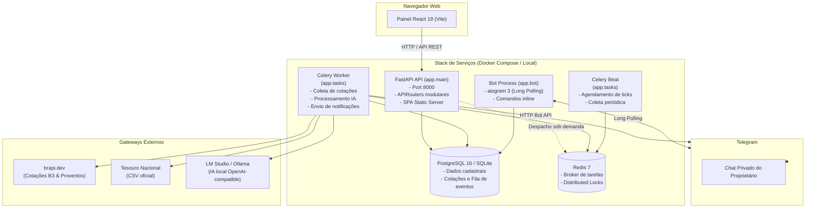
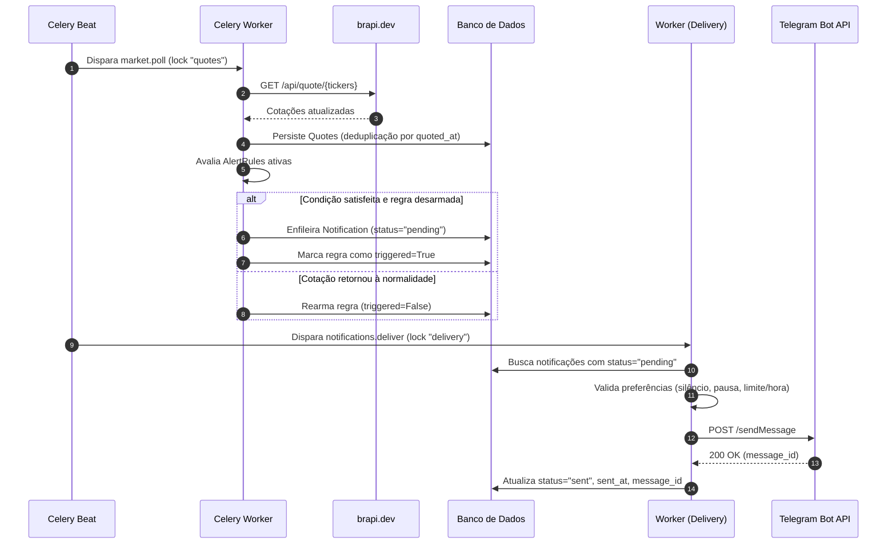
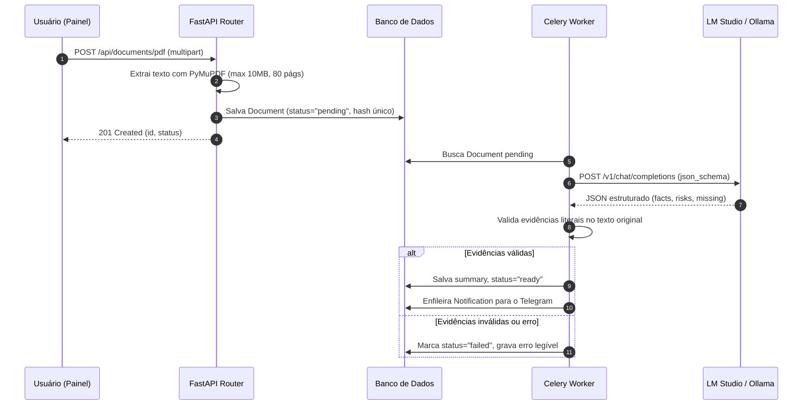

# Arquitetura do Telegram Money

Este documento descreve a arquitetura técnica do Telegram Money, os padrões de organização dos componentes, fluxos de dados, garantias de segurança e o plano de evolução do sistema.

---

## 1. Visão Geral e Princípios

O **Telegram Money** é uma solução de monitoramento patrimonial e cotações voltada para **uso estritamente pessoal** (single-owner). Os princípios orientadores da arquitetura são:

1. **Simplicidade e Propósito Claro**: Foco no investidor individual; não há multi-tenancy, cobrança, RBAC ou registro aberto de usuários.
2. **Modularidade por Domínio**: Separação clara de responsabilidades no backend (FastAPI com `APIRouter` e services isolados) e no frontend (React 19 organizado por `features/`).
3. **Privacidade e Soberania dos Dados**: Dados financeiros residem localmente ou sob infraestrutura própria; resumos de IA são processados localmente (LM Studio ou Ollama); sem telemetria ou analytics externos.
4. **Resiliência e Idempotência**: Coleta e entrega de notificações usam chaves de deduplicação e estado transacional persistente.
5. **Segurança por Padrão**: Proteção CSRF por validação de origem estrita, cookies de sessão `HttpOnly`/`SameSite=Strict`, senhas com salt e PBKDF2, e cabeçalhos de segurança (CSP, no-referrer, nosniff, frame-deny).

---

## 2. Visão de Contêineres e Processos



### Componentes em Execução

| Componente | Tecnologia | Responsabilidade |
| --- | --- | --- |
| **API** | FastAPI (Python 3.12+), Uvicorn | Expõe endpoints REST modulares, valida sessões/origem e entrega arquivos estáticos compilados do frontend. |
| **Painel Web** | React 19, Vite, Vanilla CSS | Interface de usuário responsiva em pt-BR com navegação por abas e gestão do portfólio. |
| **Worker** | Celery com Redis | Executa tarefas demoradas em segundo plano (coleta de cotações, geração de relatórios, resumos de IA, entrega de mensagens). |
| **Beat** | Celery Beat | Disparador de agendamentos para o worker (quotes a cada N seg, notificações a cada 10s, Tesouro às 10h10/15h10). |
| **Bot** | aiogram 3 | Processo independente de polling com a API do Telegram; atende comandos rápidos (`/carteira`, `/cotacao`, etc.). |
| **Banco de Dados** | PostgreSQL 16 / SQLite WAL | Persistência relacional com SQLAlchemy 2.0 e versionamento com Alembic. |
| **Broker de Fila** | Redis 7 | Mensageria Celery e locks atômicos de concorrência. |

---

## 3. Arquitetura do Backend

A camada de backend foi estruturada segundo o padrão modular do FastAPI, separando claramente infraestrutura, rotas, regras de negócio e persistência.

```
backend/
├── app/
│   ├── main.py              # Ponto de entrada: lifespan, middlewares, montagem de rotas e estáticos
│   ├── auth.py              # Hash de senhas, sessões seguras e dependency injection de proprietário
│   ├── config.py            # Pydantic Settings com carregamento de variáveis de ambiente
│   ├── crud.py              # Utilitários de acesso a dados (rows, audit)
│   ├── db.py                # Engine SQLAlchemy 2.0, sessão local e hook PRAGMA SQLite
│   ├── models.py            # Entidades Declarative ORM mapeadas com Mapped[]
│   ├── schemas.py           # Contratos de entrada e validação Pydantic v2
│   ├── bot.py               # Bot aiogram e lógica de atendimento no Telegram
│   ├── tasks.py             # Definição e locks de tarefas Celery
│   ├── seed.py              # Dados mock para execução em DEMO_MODE
│   ├── cli.py               # Ferramentas administrativas de terminal (reset de senha, import-b3)
│   ├── routers/             # Submódulos modulares por domínio funcional
│   │   ├── auth.py          # /api/auth/login, /api/auth/logout, /api/me, /api/preferences
│   │   ├── portfolio.py     # /api/overview, /api/assets, importação B3 (/api/assets/import-b3), histórico
│   │   ├── rules.py         # /api/rules (CRUD e ativação/desativação)
│   │   ├── notifications.py # /api/notifications e reenvio manual
│   │   ├── events.py        # /api/events (proventos e fatos relevantes)
│   │   ├── documents.py     # /api/documents, upload de PDF e acionamento de resumos
│   │   ├── treasury.py      # /api/treasury (taxas do Tesouro Direto)
│   │   ├── reports.py       # /api/reports (relatórios de mercado sob demanda)
│   │   ├── integrations.py  # Conexão Telegram, teste de envio, verificação de IA
│   │   └── system.py        # /health, /api/setup, /api/audit
│   └── services/            # Serviços de domínio e clientes externos
│       ├── ai.py            # Integração local com LM Studio e Ollama
│       ├── alerts.py        # Avaliação de regras de disparo e deduplicação
│       ├── delivery.py      # Fila e envio de mensagens para o Telegram
│       ├── documents.py     # Extração de texto e orquestração de resumos
│       ├── events.py        # Upsert idempotente de eventos corporativos
│       ├── portfolio.py     # Consolidação patrimonial e parser de posição B3 (.xlsx/.csv)
│       ├── providers.py     # Clientes de coleta (brapi v2 e Tesouro CSV)
│       └── reports.py       # Montagem de relatórios formatados em texto
```

---

## 4. Arquitetura do Frontend

O frontend adota arquitetura modular por funcionalidades (**Feature-driven Architecture**) com controles estritos de qualidade:

- **src/features/**: Cada tela ou domínio funcional (`assets`, `alerts`, `documents`, `events`, `overview`, `reports`, `settings`, `treasury`, `notifications`) agrupa seus componentes, formulários e lógica especializada.
- **src/app/**: Orquestração geral da aplicação (`App.jsx`, `useApp.js`, `usePanelData.js`).
- **src/components/ui/**: Componentes de design system agnósticos a domínio (`Button`, `Modal`, `Badge`, `Field`, etc.).
- **src/services/api.js**: Cliente HTTP centralizado que cuida de CSRF headers, credenciais de cookies, tratamento de erro tipado e suporte a cancelamento por `AbortSignal`.
- **Limites de Engenharia**:
  - Complexidade ciclomática máxima: 10.
  - Linhas máximas por função: 150.
  - Parâmetros máximos por função: 5.
  - Zero warnings no ESLint e 100% de cobertura nos testes do painel.

---

## 5. Fluxos de Dados Críticos

### 5.1 Coleta de Mercado e Avaliação de Alertas



### 5.2 Importação e Resumo com IA Local



---

## 6. Garantias de Segurança

1. **Proteção contra Cross-Site Request Forgery (CSRF)**:
   - Todo request mutativo (`POST`, `PUT`, `PATCH`, `DELETE`) em rotas `/api/` é interceptado por middleware que verifica o header `Origin` contra `settings.app_origin`. Requisições de origens diferentes são bloqueadas com HTTP 403.
2. **Sessão Segura**:
   - Cookie `tm_session` é gravado com flags `HttpOnly`, `SameSite=Strict` e `Secure` (em produção com HTTPS). O token trafega apenas como cookie e seu hash SHA-256 é verificado na tabela `auth_sessions`.
3. **Proteção de Força Bruta**:
   - Janela deslizante de 15 minutos com bloqueio após 10 tentativas incorretas (`LoginAttempt`).
4. **Isolamento de Redes no Compose**:
   - `db` e `redis` não expõem portas no host. Somente a `api` expõe `127.0.0.1:8000`.

---

## 7. Próximos Passos de Evolução Arquitetural (Roadmap)

Embora a arquitetura atual seja robusta e modularizada, as seguintes evoluções estruturais podem ser consideradas para simplificação futura:

1. **Unificação do Runtime de Background (Async Tasks vs Celery/Redis)**:
   - *Cenário Atual*: Celery + Celery Beat + Redis adicionam 3 contêineres e ~500MB de RAM para 1 usuário.
   - *Evolução Possível*: Adotar um agendador assíncrono nativo em Python (`APScheduler` integrado com `asyncio` e background tasks do FastAPI), reduzindo a infraestrutura para apenas 1 ou 2 contêineres e eliminando completamente a dependência de Redis.
2. **Contratos Estritos de Saída (Pydantic Response Models)**:
   - Adicionar schemas `response_model` em cada rota dos routers para formalizar 100% dos retornos no OpenAPI / Swagger e eliminar a necessidade de `jsonable_encoder`.
3. **Revalidação Otimizada no Frontend**:
   - Substituir o polling fixo de 30s por revalidação orientada a foco de janela (`document.visibilityState`) e mutações bem-sucedidas.
